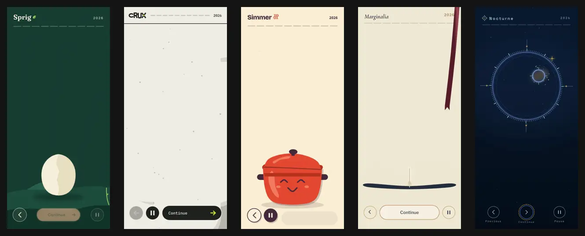

# Rive-Recap



**An example showcase of ten fictional apps, each with its own Wrapped-style year-in-review built in [Rive](https://rive.app).** It shows how quickly a personalised, animated recap can be generated for your own app: every experience here started from a written brief and was built end to end with the [Rive CLI](https://rive.app/docs) — vector art, ten scenes, motion, personas, a share card and a data-bound runtime model — into a `.riv` that ships straight into an app.

Every app is a different visual world, and every one runs on the same contract: one `UserRecap` view model that your app fills with real numbers.

| App | Domain | Style | Recap |
|---|---|---|---|
| [Sprig](apps/sprig/PROMPT.md) | Houseplant care | Folded-paper botanical dioramas | [video](apps/sprig/video.webp) · [project](apps/sprig/rive/) |
| [Crux](apps/crux/PROMPT.md) | Indoor climbing | Brutalist climbing-wall graphics | [video](apps/crux/video.webp) · [project](apps/crux/rive/) |
| [Simmer](apps/simmer/PROMPT.md) | Home cooking | Risograph cookbook collage | [video](apps/simmer/video.webp) · [project](apps/simmer/rive/) |
| [Marginalia](apps/marginalia/PROMPT.md) | Reading journal | Literary book-jacket design | [video](apps/marginalia/video.webp) · [project](apps/marginalia/rive/) |
| [Nocturne](apps/nocturne/PROMPT.md) | Stargazing journal | Observatory instrument graphics | [video](apps/nocturne/video.webp) · [project](apps/nocturne/rive/) |
| [Kiln](apps/kiln/PROMPT.md) | Ceramics studio | Sculptural ceramic silhouettes | [video](apps/kiln/video.webp) · [project](apps/kiln/rive/) |
| [Switchyard](apps/switchyard/PROMPT.md) | Public transit | Swiss transit posters | [video](apps/switchyard/video.webp) · [project](apps/switchyard/rive/) |
| [Stash](apps/stash/PROMPT.md) | Personal savings | Retro toy-bank arcade | [video](apps/stash/video.webp) · [project](apps/stash/rive/) |
| [Parlance](apps/parlance/PROMPT.md) | Language practice | Kinetic typography posters | [video](apps/parlance/video.webp) · [project](apps/parlance/rive/) |
| [Patchwork](apps/patchwork/PROMPT.md) | Local volunteering | Quilted textile collage | [video](apps/patchwork/video.webp) · [project](apps/patchwork/rive/) |

All apps, names and statistics are fictional sample data for the year 2026.

## What each recap includes

- Ten scenes: an invitation, seven personalised stats, a persona reveal and a shareable summary.
- One global `UserRecap` view model — every number, string, colour, persona and visibility flag is bound to it, so your app sets the data once.
- A sequencing state machine: tap right/left to navigate, hold to pause, keyboard support, auto-advance, progress segments that adapt to hidden scenes, replay.
- Events for your host app: `screenChanged`, `shareTapped`, `recapFinished`.
- Four personas with distinct emblems and choreography, reduced-motion variants, and new-user / extreme-value fixtures.

Each project's `README.md` documents its exact binding and event contract, fonts and licences, and known limitations.

## How it was made

1. [PROMPT_TEMPLATE.md](PROMPT_TEMPLATE.md) describes a recap in general terms: scenes, data model, navigation, motion and verification.
2. Each app gets a brief adapted from it — `apps/<app>/PROMPT.md` with a concept image, palette and sample data ([gallery](apps/README.md)).
3. An agent reads the brief and builds the project with the Rive CLI: RML scene source, artwork, state machines and data binding, checked with `rive <project> --verify`, `rive inspect` and headless screenshots, then exported with `rive <project> --once`.

To make one for your own app, copy the template, describe your product, metrics and visual direction, and run the same loop.

**Recommended model:** Anthropic Claude Opus 5.5 (at the time of writing, October 2026). All ten recaps in this repository were built with it, one agent per app working in parallel.

## Use a recap in your app (web)

Install the [Rive web runtime](https://rive.app/docs/runtimes/web/web-js):

```bash
npm install @rive-app/canvas
```

Load the `.riv`, auto-bind its `UserRecap` view model, fill it with your user's data and listen for the recap's events:

```html
<canvas id="recap" style="width: 390px; height: 844px"></canvas>
```

```js
import { Rive, Layout, Fit, Alignment, EventType } from "@rive-app/canvas";

const recap = new Rive({
  src: "/sprig-recap.riv",
  canvas: document.getElementById("recap"),
  stateMachines: "Recap",
  autoplay: true,
  autoBind: true, // binds the artboard's UserRecap view model instance
  layout: new Layout({ fit: Fit.Contain, alignment: Alignment.Center }),
  onLoad: () => {
    recap.resizeDrawingSurfaceToCanvas();

    // Write your user's stats into the single shared view model.
    const data = recap.viewModelInstance;
    data.string("userName").value = user.firstName;
    data.number("plantsNurtured").value = stats.plantsNurtured;
    data.number("careMoments").value = stats.careMoments;
    data.number("personaIndex").value = stats.personaIndex;
    data.string("personaName").value = personas[stats.personaIndex].name;
    data.boolean("reducedMotion").value =
      matchMedia("(prefers-reduced-motion: reduce)").matches;

    // Observe the state machine's progress.
    data.number("currentScreen").on((event) => console.log("scene", event.data));
  },
});

recap.on(EventType.RiveEvent, ({ data }) => {
  if (data.name === "shareTapped") shareSummaryCard(); // your capture + share sheet
  if (data.name === "recapFinished") analytics.track("recap_finished");
});
```

Property and state machine names come from each project's `README.md`. Build the `.riv` with `rive apps/<app>/rive --once`; projects that contain Luau scripts (every app except Sprig, Parlance and Patchwork) must instead be built signed with `rive apps/<app>/rive --publish`, because web runtimes reject unsigned scripts.

Full documentation: [Rive web runtime](https://rive.app/docs/runtimes/web/web-js) · [Data binding on the web](https://rive.app/docs/runtimes/web/data-binding) · [All runtimes](https://rive.app/docs/runtimes/getting-started)

## Preview and render

```bash
rive apps/simmer/rive                 # live preview window, rebuilds on edit
scripts/render-video.py simmer        # apps/simmer/video.webm
scripts/merge-videos.py               # apps/showcase.webm: five apps side by side, two sequences
scripts/render-all.sh                 # re-render every app's video, then the showcase
```

The video scripts drive each recap headlessly with `rive --screenshot` (one run per frame, in parallel, pressing Right every 3.5 s) and encode directly to VP9 WebM with `ffmpeg` (`brew install ffmpeg`, with the `libvpx-vp9` encoder). The merger reads `apps/<app>/video.webm` and writes `apps/showcase.webm`; no MP4 intermediate or `img2webp` is needed. The `--quality` option remains 0–100 (higher is better), mapped to VP9 CRF 63–0. Looping is controlled by the video player. Run `scripts/render-video.py --help` for frame rate, timing and fixture options.

The checked-in WebP previews above are from the earlier pipeline and remain available. Re-running the scripts produces WebM files alongside them; link WebM outputs as videos rather than Markdown images.
