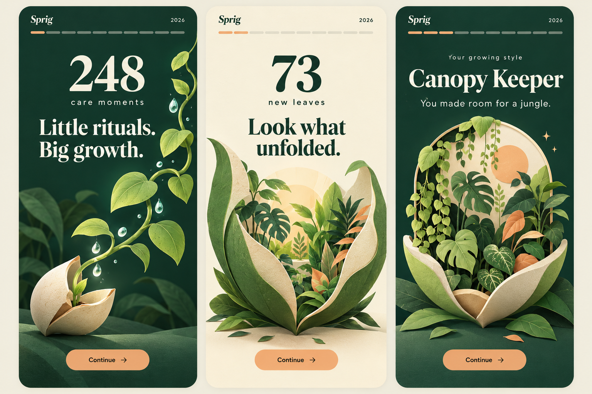
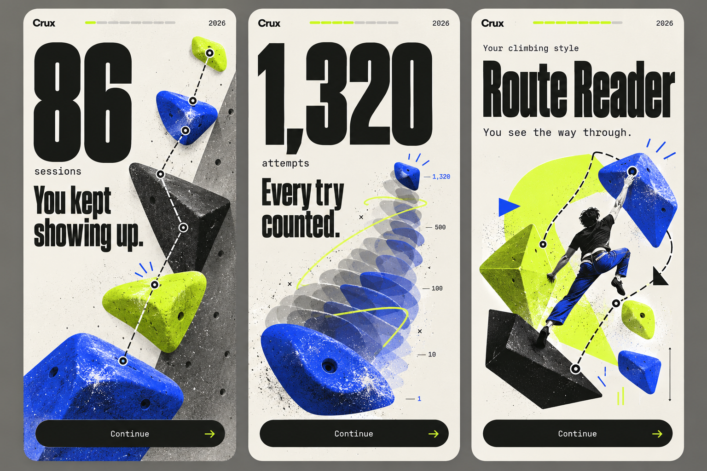
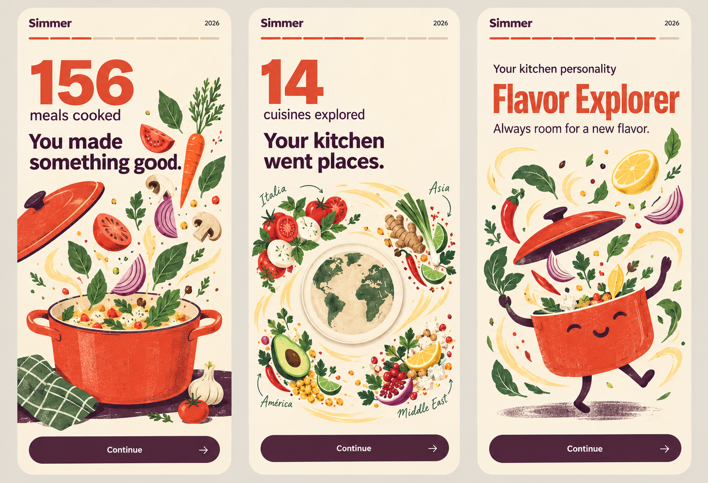
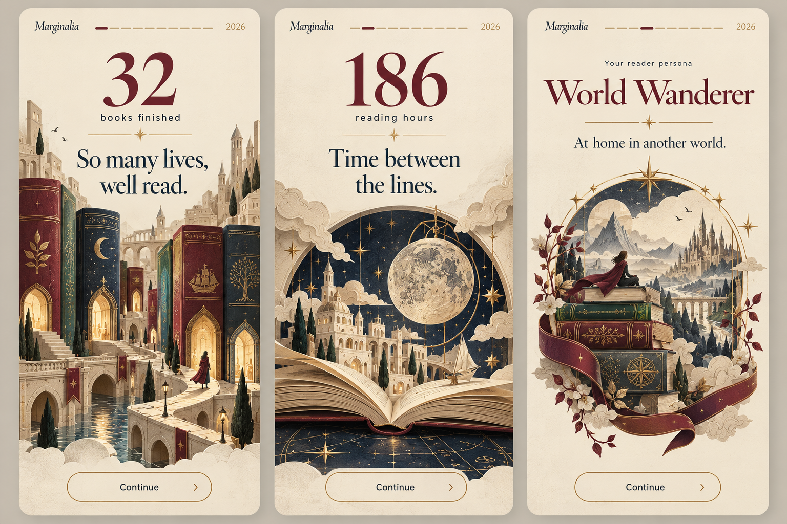
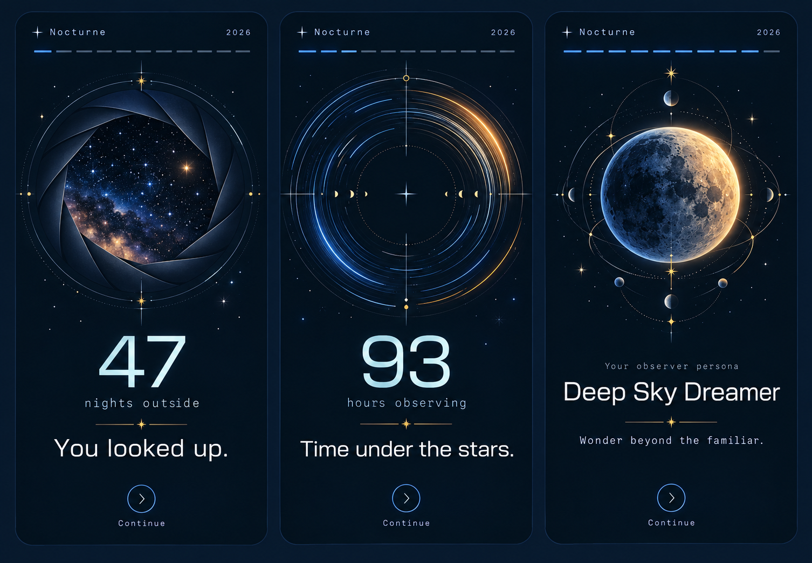
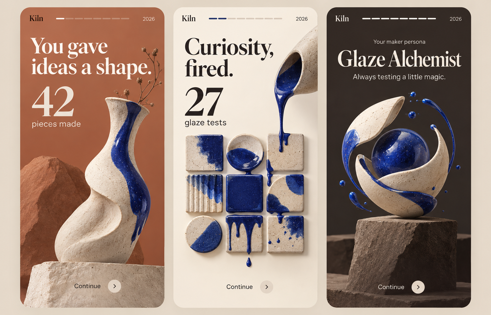
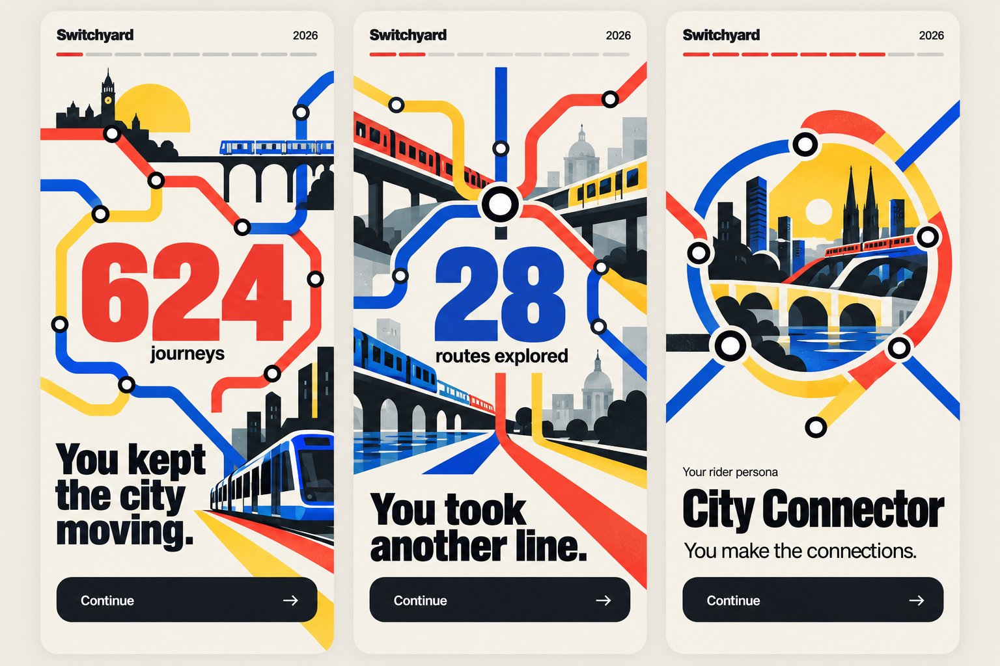
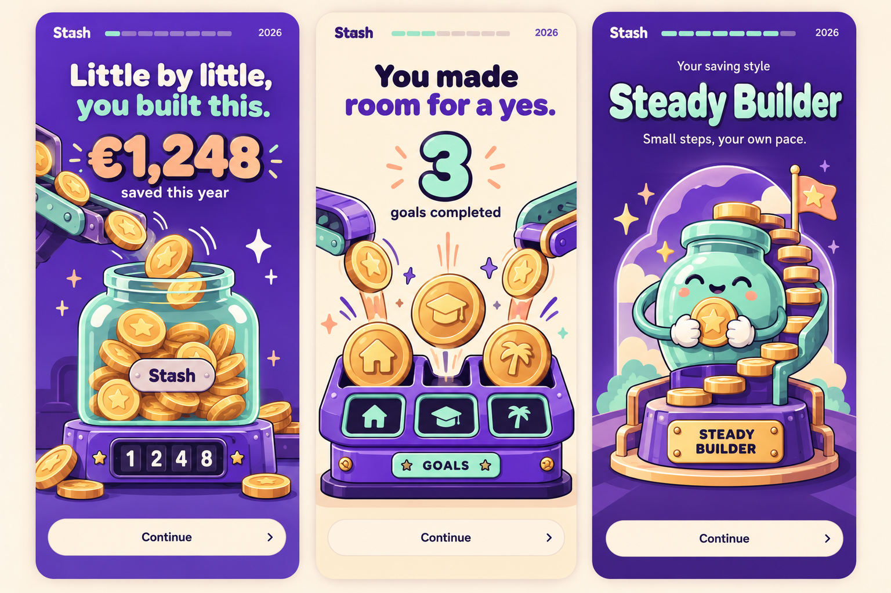
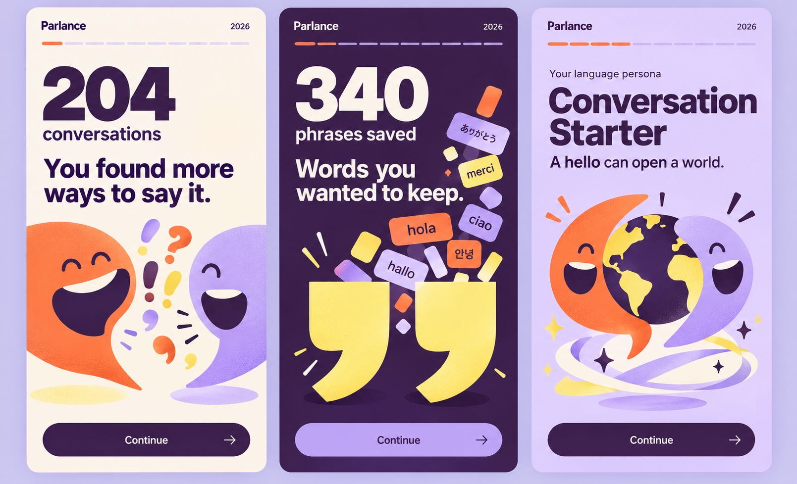
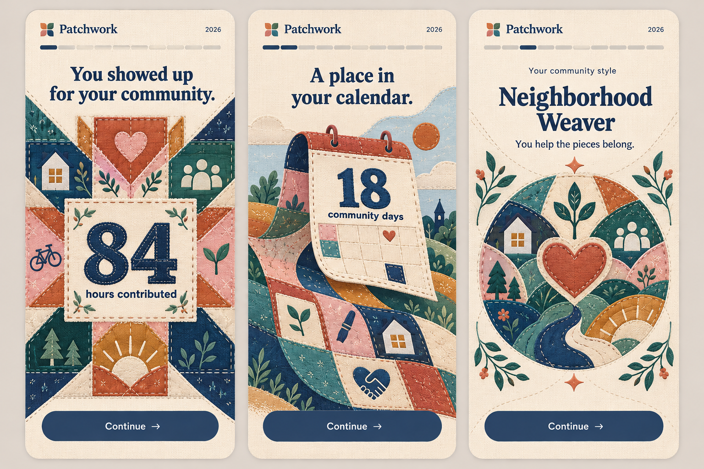

# Fictional Rive recap apps

Ten independent briefs for ten-screen Wrapped-style experiences. Each directory includes a complete `PROMPT.md`, a generated `concept.png` containing three illustrative screenshots (screens 2, 4, and 9), the exact `IMAGE_PROMPT.md`, and a `sample-data.json` fixture. These are fictional concept packages, not implemented apps or finished Rive animations.

The briefs adapt [the root template](../PROMPT_TEMPLATE.md), retaining one global runtime view model, the ten-scene story, navigation, progress, persona selection, sharing, and verification. All sample data describes the fictional full year 2026.

| App | Domain | Visual / motion approach | Deliverables |
|---|---|---|---|
| Sprig | Houseplant care | Folded-paper botanical dioramas; a growing vine becomes the next screen's frame | [Prompt](sprig/PROMPT.md) · [Illustration](sprig/concept.png) · [Data](sprig/sample-data.json) |
| Crux | Indoor climbing | Brutalist climbing-wall graphics; a taut route line yanks the composition upward into the next wall panel | [Prompt](crux/PROMPT.md) · [Illustration](crux/concept.png) · [Data](crux/sample-data.json) |
| Simmer | Home cooking | Risograph cookbook collage; a steam ribbon curls into the next layout, followed by a tablecloth pull that rearranges ingredients | [Prompt](simmer/PROMPT.md) · [Illustration](simmer/concept.png) · [Data](simmer/sample-data.json) |
| Marginalia | Reading journal | Literary book-jacket design with etched illustration; a page turn reveals the next scene | [Prompt](marginalia/PROMPT.md) · [Illustration](marginalia/concept.png) · [Data](marginalia/sample-data.json) |
| Nocturne | Stargazing journal | Observatory instrument graphics; the observatory aperture closes to a small pupil then opens on a different scale of sky | [Prompt](nocturne/PROMPT.md) · [Illustration](nocturne/concept.png) · [Data](nocturne/sample-data.json) |
| Kiln | Ceramics studio journal | Sculptural ceramic silhouettes; a continuous vessel silhouette compresses into a clay slab that expands into the next gallery plinth | [Prompt](kiln/PROMPT.md) · [Illustration](kiln/concept.png) · [Data](kiln/sample-data.json) |
| Switchyard | Public transit diary | Swiss transit posters; a moving route dot enters an interchange ring that expands to become the next screen | [Prompt](switchyard/PROMPT.md) · [Illustration](switchyard/concept.png) · [Data](switchyard/sample-data.json) |
| Stash | Goal-based personal savings | Retro toy-bank and arcade graphics; a coin exits one track and lands on a spring that pushes the next scene into view | [Prompt](stash/PROMPT.md) · [Illustration](stash/concept.png) · [Data](stash/sample-data.json) |
| Parlance | Language conversation practice | Kinetic typography posters; a speech bubble elongates to fill the frame and opens as a quotation mark on the next scene | [Prompt](parlance/PROMPT.md) · [Illustration](parlance/concept.png) · [Data](parlance/sample-data.json) |
| Patchwork | Local volunteering | Quilted textile collage; a running stitch guides a fabric fold that reveals the next patch | [Prompt](patchwork/PROMPT.md) · [Illustration](patchwork/concept.png) · [Data](patchwork/sample-data.json) |

## Use a brief

Open an app's PROMPT.md together with its concept.png in a configured Rive CLI project. Follow the project's own agent instructions and installed tool documentation. The image is an art-direction reference: recreate its motif as editable, animatable layers and use the brief as the source of truth for exact copy, UI controls, and bindings. Fonts and implementation assets are specified but not bundled.

Every brief calls for app-specific hero choreography, continuity transitions, an interactive flourish, four distinct persona treatments, a share composition, reduced motion, and practical validation. The images were generated using the built-in image generation tool; exact source prompts are preserved beside them.

## Concept source

[concepts.json](concepts.json) records the concepts, palettes, metrics, and image prompts for future iteration. PROMPT.md is the implementation contract; sample-data.json is a fixture for its logical global model. The Rive integration may require documented type and formatting adapters.

## Gallery

### Sprig — Houseplant care

[Implementation prompt](sprig/PROMPT.md)

### Crux — Indoor climbing

[Implementation prompt](crux/PROMPT.md)

### Simmer — Home cooking

[Implementation prompt](simmer/PROMPT.md)

### Marginalia — Reading journal

[Implementation prompt](marginalia/PROMPT.md)

### Nocturne — Stargazing journal

[Implementation prompt](nocturne/PROMPT.md)

### Kiln — Ceramics studio journal

[Implementation prompt](kiln/PROMPT.md)

### Switchyard — Public transit diary

[Implementation prompt](switchyard/PROMPT.md)

### Stash — Goal-based personal savings

[Implementation prompt](stash/PROMPT.md)

### Parlance — Language conversation practice

[Implementation prompt](parlance/PROMPT.md)

### Patchwork — Local volunteering

[Implementation prompt](patchwork/PROMPT.md)
